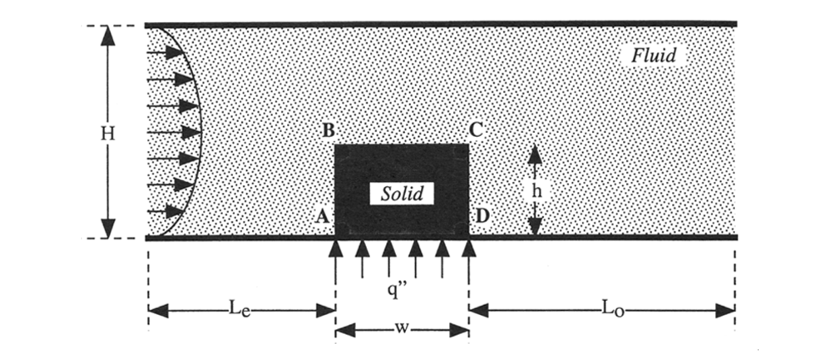
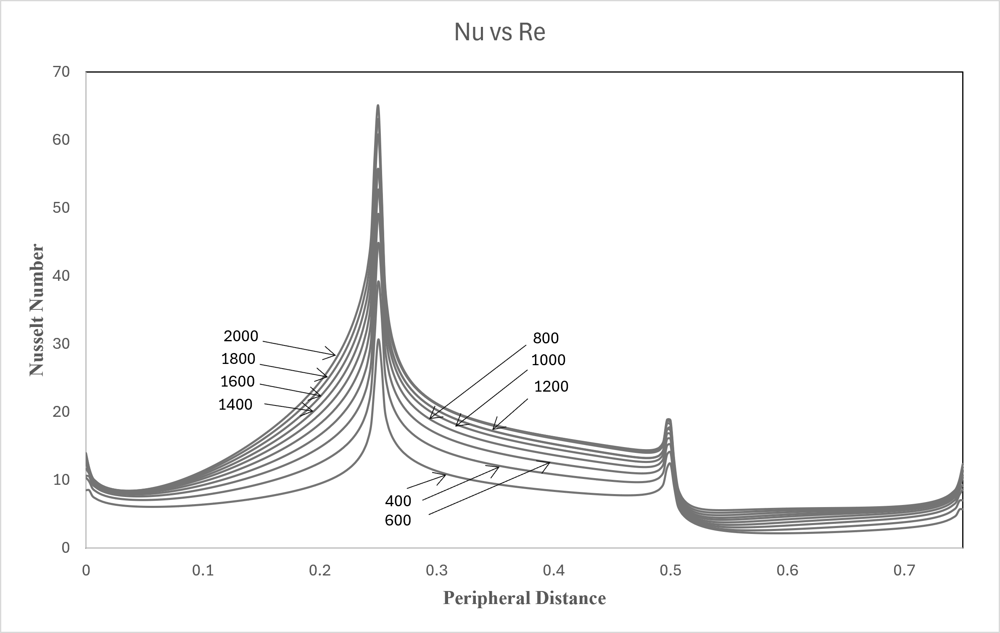
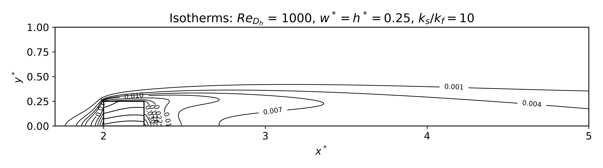
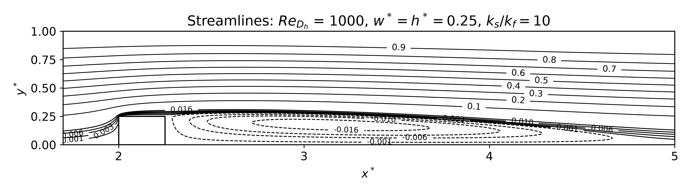

# Conjugate heat transfer reproduction study — ANSYS Fluent

**Ajay Pokhrel | Heated obstacle in a channel | Young & Vafai (1998), Case 5**

A CFD coursework and reproduction study of forced convective cooling around a conducting square obstacle mounted on a channel wall. The project combines ANSYS Fluent case files, a parabolic inlet velocity UDF, local Nusselt-number exports, Python contour post-processing, and original technical reports.



**Status:** preserved simulation archive with documented reproducibility checks. Saved-case settings and report descriptions disagree in several places. This repository does **not** claim that a new laminar benchmark validation or a new Fluent rerun has been completed. Read the [verification notes](docs/verification-notes.md) before reusing numerical claims.

## Study scope

The main report focuses on the square-obstacle configuration with `w/H = h/H = 0.25`, solid/fluid conductivity ratio `ks/kf = 10`, and folder-labelled Reynolds numbers 200–2000. Supplementary cases for conductivity ratios 1 and 100 are included where present. The saved sweep is incomplete for some supplementary combinations.

| Quantity | Documented value |
|---|---|
| Channel height H | 0.1 m |
| Obstacle width and height | 0.025 m each |
| Upstream / downstream lengths | 0.2 m / 0.8 m |
| Inlet temperature | 300 K |
| Base heat flux | 10 W/m² |
| Fluid conductivity | 0.0242 W/(m·K) |
| Main-report solid conductivity | 0.242 W/(m·K) |
| Inlet | Parabolic profile supplied through a compiled UDF |
| Saved case version | Fluent 26.1 (2026 R1) |
| Standard saved mesh | Cell IDs through 115,933 |
| Additional Re1000 mesh | Cell IDs through 253,687 |

The thermal and geometric values above describe the supplied documentation. The version and cell-ID counts were read directly from the HDF5 case files. Model consistency requires further review: the saved cases have `rp-lam? = #f` and `rp-kw? = #t`, although the report calls the study laminar.

## Repository contents

| Location | Contents |
|---|---|
| [native/](native/) | ZIP archives grouped by original Reynolds-number folder; all 28 saved `.cas.h5` files, available UDF sources, small exports, and transcripts |
| [native/Re1000.zip](native/Re1000.zip) | Includes the representative `ks_by_kf=10` case/data pair and the additional finer-mesh case |
| [native/geometry.zip](native/geometry.zip) | Original SpaceClaim geometry and associated geometry files |
| [udf/original-template.cpp](udf/original-template.cpp) | Unmodified generic inlet-UDF template; case-specific versions are in the native archives |
| [postprocessing/](postprocessing/) | CSV field exports and original Python plotting scripts for labels 200, 800, 1000, 1400, and 2000 |
| [results/figures/](results/figures/) | Original geometry, mesh, temperature, streamline, and Nusselt figures |
| [results/original-workbooks.zip](results/original-workbooks.zip) | Original Excel calculation/plot workbooks and exported PDF |
| [docs/](docs/) | Original reports, LaTeX draft archive, case inventory, source manifest, and verification notes |

The native archives preserve the original relative file names. Extract the archive you need before opening a case. The full package is approximately 120 MB; individual archives can also be downloaded separately from GitHub.

## Open a saved case

1. Use a licensed installation of ANSYS Fluent compatible with **2026 R1**, in **2D double precision**. Compatibility with older releases has not been tested.
2. Extract [Re1000.zip](native/Re1000.zip) to a writable working directory. Begin with its `ks_by_kf=10` folder, which contains both `spaceclaim_geometry.cas.h5` and `spaceclaim_geometry.dat.h5`.
3. Read the case and matching data through Fluent's file menu. Other archives mainly contain setup/mesh files and require initialization and a new solve to regenerate a solution.
4. Rebuild and load the UDF from the source supplied for that case, using Fluent's compiled-function interface. Compiled DLLs and machine-specific build products were deliberately excluded. A missing-library warning on loading an archived case may require rebuilding/reloading `libudf` and reattaching `parabolic_inlet_velocity` to inlet x-velocity.
5. Inspect the active viscous model, energy equation, material properties, solid/fluid interfaces, obstacle-base heat flux, and inlet profile. Check them against your intended reproduction protocol before starting a new run. Do not silently treat the saved turbulence settings as laminar.
6. Review convergence histories, heat balance, and mesh sensitivity. Save any corrected or newly solved configuration under a new name, retaining the archived baseline.

The `compute_nusselt` adjustment function in the supplied UDF is an empty placeholder; it does not calculate Nusselt numbers. Use a verified Fluent surface report or explicit post-processing definition instead.

## Reynolds-number convention

The UDF computes mean speed as:

```text
Umean = RE_H × mu / (rho × H)
u(y) = 6 × Umean × y(H-y) / H²
```

The original UDF uses `H = 0.1 m`, `rho = 1.225 kg/m³`, and `mu = 1.7894e-5 Pa·s`. For the folder labelled Re1000, the located source uses `RE_H = 500`, giving `Umean ≈ 0.07309 m/s`, consistent with that saved case's reference velocity. This is consistent with a folder label based on `Dh = 2H`. The generic template instead contains `RE_H = 200` and must not be assumed correct for every case.

Preserve the original labels when discussing archived results, and explicitly state whether Reynolds number is based on `H` or `2H` when making comparisons. [Case inventory](docs/case-inventory.csv) records available UDF constants and saved reference values. A reference velocity alone does not prove the velocity field or which compiled UDF was used for the historical solve.

## Reproduce the existing Python plots

Extract, for example, [postprocessing/Re1000.zip](postprocessing/Re1000.zip). Keep `plot_contour.py`, `fluid_Re1000.csv`, and `solid_Re1000.csv` together. In an isolated Python environment:

```bash
python -m pip install numpy pandas scipy matplotlib
python plot_contour.py
```

Run the script from the extracted folder. These are the original scripts and field exports, not newly computed Fluent results. Plot regeneration was not executed during packaging. Scripts were checked for Python syntax only. Dependency versions were not recorded in the original project.

The Re200 isotherm image has an original filename containing `Re1000`; it remains inside `results/figures/Re200/` and is flagged in the verification notes instead of being silently relabelled.

## Original results







The [original report](docs/original-report.pdf) discusses a conductivity-ratio-10 sweep and claims 1.15% mean correlation error. The [original presentation](docs/original-presentation.pdf) describes an earlier ratio-1 study. They are separate historical documents, not interchangeable descriptions of one validated setup. Their quantitative validation and grid-independence claims have not been independently established in this packaging review.

## Reference and attribution

T. J. Young and K. Vafai, **“Convective cooling of a heated obstacle in a channel,”** *International Journal of Heat and Mass Transfer* 41 (1998), 3131–3148. [DOI: 10.1016/S0017-9310(97)00323-2](https://doi.org/10.1016/S0017-9310(97)00323-2).

The reference article is linked, not redistributed. Original course attribution and report authorship are retained. ANSYS Fluent is proprietary software and is not included. No new blanket license has been assigned to the supplied project materials.
